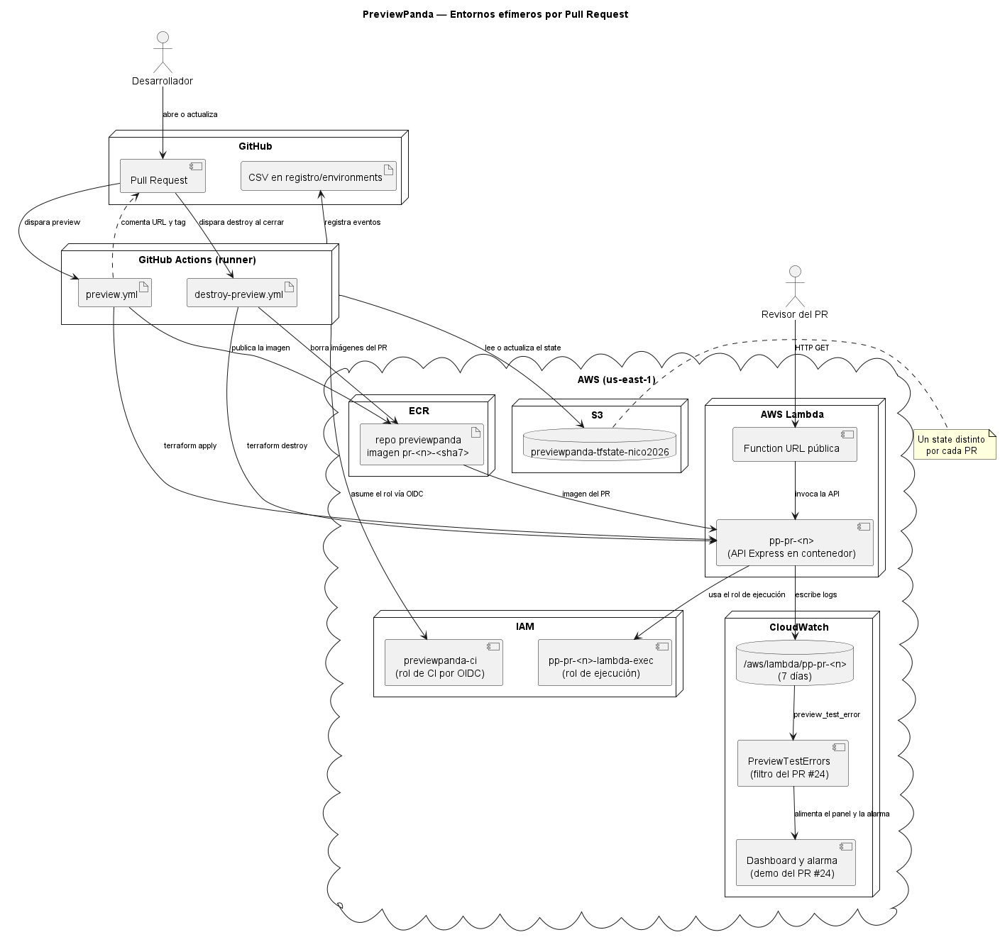
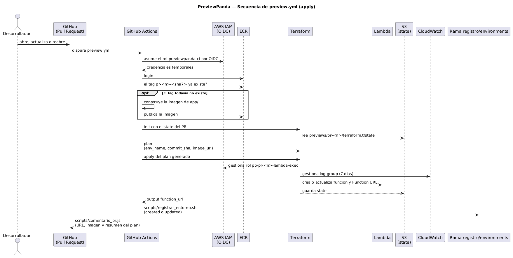
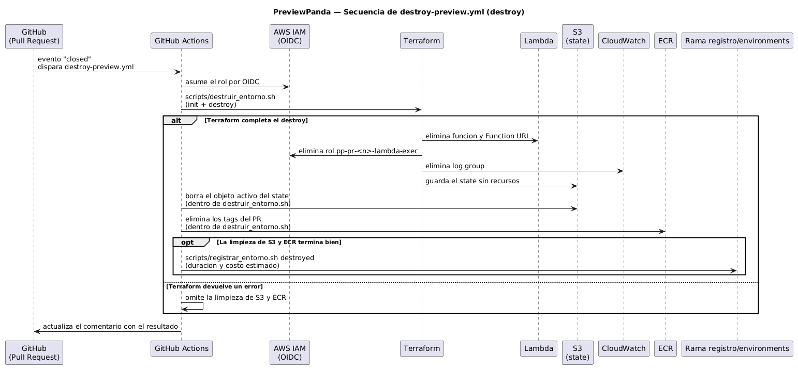
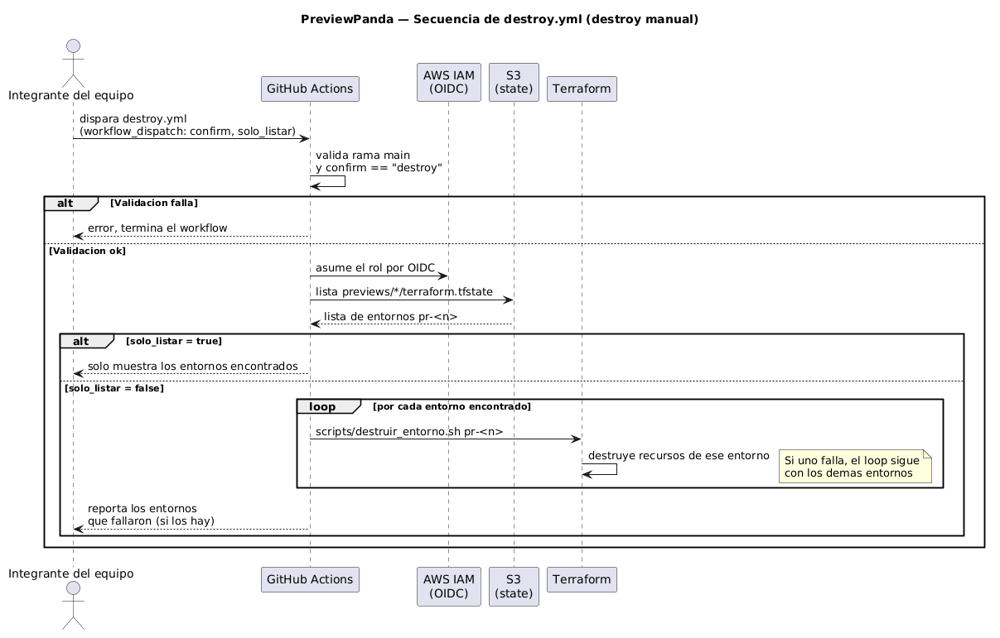

# PreviewPanda

## Informe de proyecto

**Proyecto:** PreviewPanda – entornos efímeros por Pull Request  
**Proveedor:** Amazon Web Services (AWS)  
**Repositorio:** `previewpanda`  
**Rama de desarrollo de la aplicación:** `feature/app`  
**Equipo:** `Nicolás González, Felipe Corderi, Agustín García`

## 1. Resumen

Armamos PreviewPanda para que cada Pull Request tenga su propio entorno de prueba aislado. Cuando alguien abre, actualiza o reabre un PR, GitHub Actions prepara la imagen en Amazon ECR y usa Terraform para desplegar la API en AWS Lambda. El comentario que deja en el PR incluye la Function URL y el plan de Terraform que se aplicó.

Cuando el PR se cierra o se mergea, otro workflow corre `terraform destroy` sobre su state y borra todo lo que quedó asociado. Además, todas las noches corre una limpieza que revisa si quedó algún entorno huérfano en S3.

Con esto, quien revisa el PR puede probar ese commit directo desde el navegador antes de mergearlo. Una vez que el PR se cierra, el entorno desaparece y queda un registro de cuánto duró y cuánto costó, estimado.

## 2. Requisitos verificables

| # | Requisito | Cómo lo resolvimos |
|---:|---|---|
| 1 | Cada PR tiene su propio entorno y URL | Una Lambda `pp-pr-<n>` con su propia Function URL. |
| 2 | El entorno se destruye al cerrar o mergear | `terraform destroy` más la limpieza de todo lo asociado al PR. |
| 3 | Módulo Terraform reutilizable | La variable `env_name` genera todos los nombres del entorno. |
| 4 | Un state por entorno | Cada PR tiene su propia key en S3: `previews/pr-<n>/terraform.tfstate`. |
| 5 | Etiqueta `pr=<n>` | Tags comunes que se aplican a todos los recursos que se crean. |
| 6 | Limpieza nocturna de huérfanos | `nightly-cleanup.yml` corre `scripts/cleanup_orphans.py` todos los días a las 03:00 de Uruguay. |
| 7 | Política de concurrencia | Un grupo `preview-pr-<n>` que serializa las ejecuciones de un mismo PR. |
| 8 | Registro y costo por entorno | Los workflows escriben en el CSV que vive en la rama `registro/environments`. El PR #26 muestra los tres eventos del ciclo completo. |

**Control de calidad.** Cada PR ejecuta `Terraform Quality` para revisar el código de infraestructura con `fmt`, `validate`, TFLint y Checkov. El resultado se puede consultar en los checks del PR (ver [sección 3.2](#32-terraform-quality)).

## 3. La aplicación

Hicimos una API de Node.js con Express, chica a propósito. Corre local como servidor HTTP, y en AWS corre en Lambda con una imagen de contenedor.

Cada preview usa una imagen identificada por el número del PR y el commit. Terraform le pasa estas variables a la Lambda:

- `PR_NUMBER`: el número del Pull Request.
- `COMMIT_SHA`: el commit de la imagen que está desplegada.

### Endpoints

| Endpoint | Para qué sirve |
|---|---|
| `GET /` | Devuelve el nombre de la app, el PR, el commit y dónde está Swagger. |
| `GET /health` | Responde `200 ok`, para health checks y smoke tests. |
| `GET /error` | Devuelve un `500` a propósito, para probar logs y alarmas. |
| `GET /api-docs` | La documentación interactiva de Swagger. |

### 3.1 Cómo probamos la aplicación

Las mismas rutas las probamos primero local y después sobre la Function URL que se crea para el PR.

#### `GET /`

Sirve para confirmar qué entorno es.

```text
GET /
```

Respuesta esperada:

```json
{
  "app": "PreviewPanda",
  "pr": "12",
  "commit": "abc123d",
  "docs": "/api-docs"
}
```

El `pr` y el `commit` tienen que coincidir con lo que se está probando. Si la corremos local sin configurar nada, aparece `NOT_CONFIGURED` en los dos campos.

#### `GET /health`

Confirma que la Lambda y la app están respondiendo.

```text
GET /health
```

Resultado esperado:

```text
HTTP 200
ok
```

La usamos para chequear a mano que el entorno responde apenas se despliega.

#### `GET /error`

Genera un error a propósito para poder probar la observabilidad.

```text
GET /error
```

Resultado esperado:

```text
HTTP 500
{
  "message": "Error de prueba"
}
```

El error es intencional. En AWS queda registrado en CloudWatch Logs con la marca `preview_test_error`. Usamos un filtro de métrica sobre esa marca para la alarma de la demo, porque un `HTTP 500` que generamos nosotros no necesariamente le suma a la métrica nativa `AWS/Lambda Errors`.

#### `GET /api-docs`

Abre Swagger.

```text
GET /api-docs
```

Desde ahí se pueden probar `/`, `/health` y `/error`, tanto local como sobre la Function URL del PR.

### 3.2 Terraform Quality

Cuando se abre, actualiza o reabre un PR, corre el workflow `Terraform Quality`: revisa el formato, valida la configuración y corre TFLint sobre `infra/preview`. Inicializa Terraform con `-backend=false`, así que estos controles corren sin necesitar credenciales de AWS ni acceso al state de S3. Checkov escanea `infra/` y deja sus hallazgos en el log del job, pero con `soft_fail: true` no bloquea nada. El plan real contra AWS lo corre el workflow Preview, y ese sí se publica en el comentario del PR.

## 4. Arquitectura en AWS

Elegimos Lambda porque la API recibe poco tráfico y se invoca bajo demanda, no tiene sentido tener algo prendido todo el tiempo. La Function URL le da al revisor acceso directo al preview sin tener que meter otro servicio en el medio solo para exponer la API.

- **AWS Lambda con imagen de contenedor:** una función por Pull Request.
- **Lambda Function URL:** URL pública propia para cada preview.
- **Amazon ECR:** un repositorio compartido para las imágenes Docker.
- **Amazon S3:** guarda el state remoto de Terraform.
- **GitHub Actions:** hace el build, publica la imagen, corre Terraform y comenta en el PR.
- **GitHub Actions OIDC + IAM:** autenticación sin claves fijas.
- **Amazon CloudWatch:** logs, dashboard y alarma.

### Datos concretos

| Dato | Valor |
|---|---|
| Región | `us-east-1` |
| Cuenta AWS | `891762599659` |
| Bucket de state | `previewpanda-tfstate-nico2026` |
| Key del state | `previews/pr-<n>/terraform.tfstate` |
| Etiquetas | `project=previewpanda`, `team=previewpanda`, `env=preview`, `owner=nicolas`, `pr=<n>` |
| Lock del state | `use_lockfile = true` |
| Rol de CI | `previewpanda-ci` |

El repositorio ECR, el bucket S3, el proveedor OIDC y el rol de CI son compartidos entre todos los previews. Cada PR tiene su propia Lambda, su Function URL, su rol de ejecución, su grupo de logs, su state y sus imágenes. El dashboard y la alarma los configuramos en la consola para la prueba de observabilidad del PR #35.

## 5. Flujo de creación y destrucción

### Al abrir, actualizar o reabrir un PR

Al abrir, actualizar o reabrir un PR, GitHub Actions inicia dos workflows independientes. **Terraform Quality** revisa el código de infraestructura con `fmt`, `validate`, TFLint y Checkov (ver [sección 3.2](#32-terraform-quality)). **Preview** genera el plan y despliega el entorno sin esperar el resultado de Quality.

1. Un desarrollador abre, actualiza o reabre un Pull Request.
2. GitHub Actions obtiene credenciales temporales por OIDC.
3. El workflow busca en ECR el tag `pr-<n>-<sha7>`.
4. Si ese tag todavía no existe, construye y publica la imagen de `app/`.
5. Terraform inicializa el backend con el state de ese PR.
6. Terraform arma el plan y lo guarda en `tfplan`.
7. El workflow aplica ese mismo plan y agarra la Function URL de la Lambda `pp-pr-<n>`.
8. Se registra `created` o `updated` en el CSV de la rama `registro/environments`.
9. El workflow comenta o actualiza el comentario del PR con la URL, el commit, el tag de la imagen y el detalle del plan. Si algo falla, el comentario avisa y linkea a la ejecución.

La imagen tiene que estar en ECR antes de aplicar el plan, sino la Lambda no tiene de dónde agarrar el código. Si el tag ya existe, directamente se reusa esa imagen.

### Al cerrar o mergear el PR

1. GitHub Actions detecta el cierre o el merge.
2. El workflow llama a `scripts/destruir_entorno.sh`, que inicializa Terraform con el mismo state `previews/pr-<n>/terraform.tfstate`.
3. Corre `terraform destroy`.
4. Se borra la Lambda y todo lo asociado.
5. Se borra el objeto activo del state en S3.
6. Se borran las imágenes de ese PR en ECR.
7. Se registra la destrucción y cuánto duró el entorno en la rama `registro/environments`. Si hay una tarifa configurada, también se registra el costo estimado.
8. Se actualiza el comentario del PR con el resultado de la limpieza.

### Limpieza nocturna y destroy manual

`nightly-cleanup.yml` revisa los states de S3 todos los días a las 06:00 UTC (03:00 de Uruguay). El script no toca los entornos cuyo PR sigue abierto, ni los que no puede confirmar. Para los que están cerrados, mergeados o directamente no existen más, compara cuántos días enteros pasaron desde la última modificación del state contra `DIAS_LIMITE`, que vale 3 por defecto. Si se pasó de ese límite, lo destruye.

También dejamos un workflow manual, `destroy.yml`, que se corre desde `main`. Por defecto solo lista los entornos que hay. Si se desactiva el modo listado y se confirma con `destroy`, llama al mismo script de destrucción que usa el workflow de cierre de PR.

## 6. Concurrencia y aislamiento

Cada PR usa un state distinto y su propio grupo de concurrencia:

```text
preview-pr-<n>
```

Esto evita que dos ejecuciones del mismo PR toquen el mismo state al mismo tiempo. PR distintos sí pueden correr en paralelo sin problema.

Preview y Destroy preview comparten ese mismo grupo. En el diagrama de concurrencia mostramos el caso de dos pushes seguidos al mismo PR, y cómo el segundo espera a que termine el primero en vez de cancelarlo. La limpieza nocturna y el destroy manual usan grupos propios porque recorren varios entornos a la vez. El lock de S3 también protege el state cuando coinciden dos operaciones de Terraform. El detalle de todos los casos está en [Concurrencia.md](Concurrencia.md).

## 7. Observabilidad

Configuramos el dashboard y la alarma desde la consola de AWS para el PR #35, con la imagen `pr-35-074b400`. Para probar la alarma llamamos a `GET /error` desde la Function URL. La API responde con un 500 y escribe `preview_test_error` en CloudWatch Logs. Un filtro cuenta esas entradas en la métrica propia `PreviewTestErrors`.

En la captura se ven cinco errores de prueba, la alarma `previewpanda-pr-35-error` activada, y el panel con las métricas de Lambda `Duration`, `Errors`, `Invocations` y `Throttles`. Terraform configura la retención de los log groups en 7 días.


## 8. Seguridad e IAM

GitHub Actions se autentica en AWS por OIDC. No guardamos access keys ni secret keys en el repo.

El rol `previewpanda-ci` usa la política mínima que está documentada en [docs/previewpanda-ci-policy.json](previewpanda-ci-policy.json). La armamos y la probamos en producción con un PR real, iterando sobre los errores de permisos que fueron apareciendo, hasta sacarle `AdministratorAccess` por completo.

En la [matriz IAM](iam.md) está el detalle de qué identidad usa el proyecto, qué recursos puede tocar cada una y por qué necesita esos permisos.

## 9. FinOps

La estimación inicial para este proyecto es de **USD 0 a 2 por mes**, siempre que los previews se destruyan bien y no quede nada prendido de más. El detalle completo de supuestos y evidencias está en [docs/finops.md](finops.md).

Las medidas que más ayudan a bajar el costo:

- Lambda bajo demanda, no hay nada corriendo todo el tiempo.
- Una sola región: `us-east-1`.
- Limpieza de las imágenes de los PR que ya se cerraron.
- Destrucción automática del entorno al cerrar el PR.
- Limpieza programada de entornos que quedaron huérfanos.
- Retención de logs de solo 7 días.

En Cost Explorer vimos un costo de USD 0,00 para la ventana del 12/11/2026 al 13/11/2026, en los servicios que consultamos. Ese dato es de toda la cuenta, no podemos atribuirle un importe exacto al PR #35. Además tenemos activo el presupuesto mensual `previewpanda-presupuesto` por USD 10,00, con tres destinatarios verificados y sus tres alertas correspondientes. La pestaña de alertas confirma los umbrales: 50 % (USD 5,00), 80 % (USD 8,00) y 100 % (USD 10,00), ninguno superado en la captura. El rango de USD 0-2 es el que corresponde al alcance de la demo.

## 10. Registro de entornos

Los workflows de Preview y Destroy preview llaman a `scripts/registrar_entorno.sh` para ir agregando filas a [environments.csv](environments.csv). El historial completo queda en la rama `registro/environments`.

- Preview registra `created` al abrir o reabrir un PR, y `updated` en cada push que viene después. La fila trae el tag de ECR, la Function URL, el commit y el link a la ejecución de GitHub Actions.
- Destroy registra `destroyed` después de terminar la destrucción, borrar el state y sacar las imágenes del PR. El script usa el último `created` que encuentra para calcular cuánto duró el entorno; si no hay esa fila, usa la fecha de apertura del PR. Si está configurada la variable `PREVIEW_COST_USD_PER_HOUR`, multiplica las horas por esa tarifa; si no está, deja el costo vacío en vez de inventar un número.
- Si otro proceso toca la rama al mismo tiempo, el script reintenta el push. Y si el registro falla igual, el workflow sigue adelante: no queremos que un problema de CSV tire abajo el despliegue o la destrucción.

Las URL, fechas y tags salen de ejecuciones reales. La columna `estimated_cost_usd` es justamente eso, una estimación según cuánto duró el entorno.

### Ejemplo real: PR #26

Este registro muestra la creación, actualización y destrucción del entorno del PR #26:

```csv
pr_number,environment,event,occurred_at,image_tag,url,lifetime_hours,estimated_cost_usd,notes
26,pr-26,created,2026-11-18T03:31:38Z,pr-26-2f13196,https://y2nwlmzzxkd27ewnbkjbs6ntnm0bngqj.lambda-url.us-east-1.on.aws/,,,commit=2f13196 run=https://github.com/NicooGon/previewpanda/actions/runs/44230884299
26,pr-26,updated,2026-11-18T03:34:42Z,pr-26-b176149,https://y2nwlmzzxkd27ewnbkjbs6ntnm0bngqj.lambda-url.us-east-1.on.aws/,,,commit=b176149 run=https://github.com/NicooGon/previewpanda/actions/runs/44231284597
26,pr-26,destroyed,2026-11-18T03:35:42Z,pr-26-b176149,,0.07,0.000007,mergeado run=https://github.com/NicooGon/previewpanda/actions/runs/44231473760
```

El entorno mantuvo la misma URL cuando pasó de la imagen `pr-26-2f13196` a `pr-26-b176149`. Después del merge, el registro muestra una vida de 4 minutos y 4 segundos (`0.07` horas redondeadas) y un costo estimado de USD `0.000007`. Cada fila guarda el link a su ejecución de GitHub Actions en `notes`.

## 11. Diagramas

Armamos siete diagramas en PlantUML, desde la arquitectura general en AWS hasta un diagrama de secuencia propio para cada workflow.

### 11.1 Diagrama de despliegue AWS

Muestra qué queda en GitHub y qué se ejecuta en AWS, cómo el revisor llega a la API, y cómo los logs del PR #35 alimentan la métrica y la alarma.

Archivo fuente: [diagrama-despliegue.puml](diagrams/diagrama-despliegue.puml).



### 11.2 Diagrama de actividad de limpieza de huérfanos

Muestra las decisiones que toma el script cuando lo corre el workflow nocturno. El criterio combina el estado del PR con los días enteros que pasaron desde la última modificación del state.

Archivo fuente: [diagrama-estados-huerfanos.puml](diagrams/diagrama-estados-huerfanos.puml).


### 11.3 Diagrama de secuencia de concurrencia

Muestra cómo dos pushes seguidos al mismo PR se serializan con el grupo `preview-pr-<n>`, para que no haya dos ejecuciones tocando el mismo state a la vez.

Archivo fuente: [diagrama-secuencia-concurrencia.puml](diagrams/diagrama-secuencia-concurrencia.puml).


### 11.4 Diagrama de secuencia del workflow Terraform Quality

Muestra cómo GitHub Actions prepara el runner, revisa el Terraform y publica el resultado del job `quality`.

Archivo fuente: [diagrama-secuencia-quality.puml](diagrams/diagrama-secuencia-quality.puml).


### 11.5 Diagrama de secuencia de preview.yml (apply)

Sigue el workflow `preview.yml`: assume role por OIDC, build y push de la imagen si hace falta, `terraform apply`, registro en el CSV y comentario con la URL en el PR.

Archivo fuente: [diagrama-apply.puml](diagrams/diagrama-apply.puml).



### 11.6 Diagrama de secuencia de destroy-preview.yml (destroy)

Sigue el workflow `destroy-preview.yml` al cerrar o mergear el PR: `terraform destroy`, limpieza del state en S3, borrado de la imagen en ECR y registro de la destrucción en el CSV, incluyendo qué pasa si Terraform falla.

Archivo fuente: [diagrama-destroy.puml](diagrams/diagrama-destroy.puml).



### 11.7 Diagrama de secuencia de destroy.yml (destroy manual)

Sigue el workflow manual `destroy.yml`: valida que se corra desde `main` y con la confirmación explícita, lista los entornos que hay en S3 y, si no es solo listar, los va destruyendo uno por uno, sin frenar el loop si alguno falla.

Archivo fuente: [diagrama-destroy-manual.puml](diagrams/diagrama-destroy-manual.puml).



## 12. Resultado de las pruebas

En el PR #35 probamos la API desplegada y activamos la alarma de CloudWatch con `/error`. En el PR #26 el CSV quedó con el registro completo: el despliegue, el cambio de imagen después de un push, y el destroy tras el merge. El procedimiento para repetir el ciclo está en el [README](../README.md).
