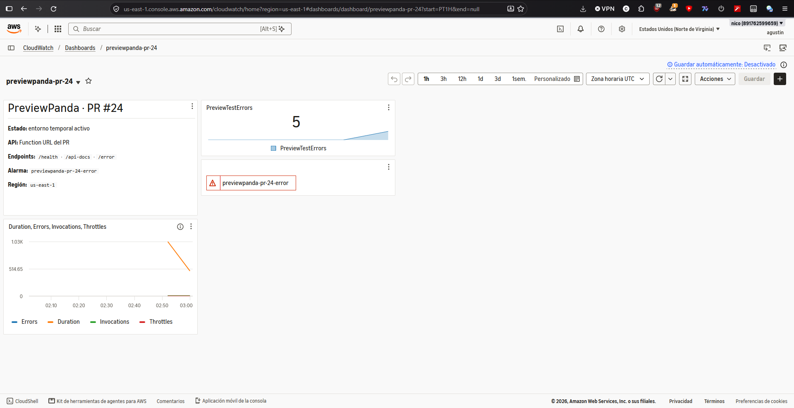
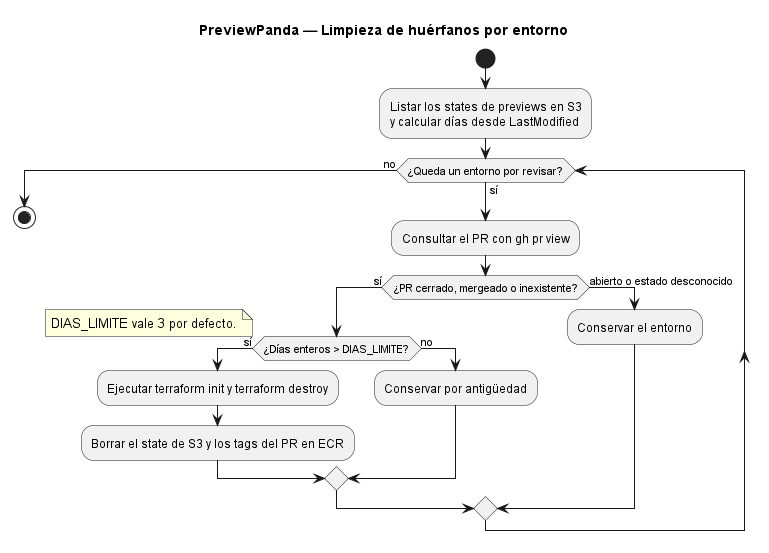
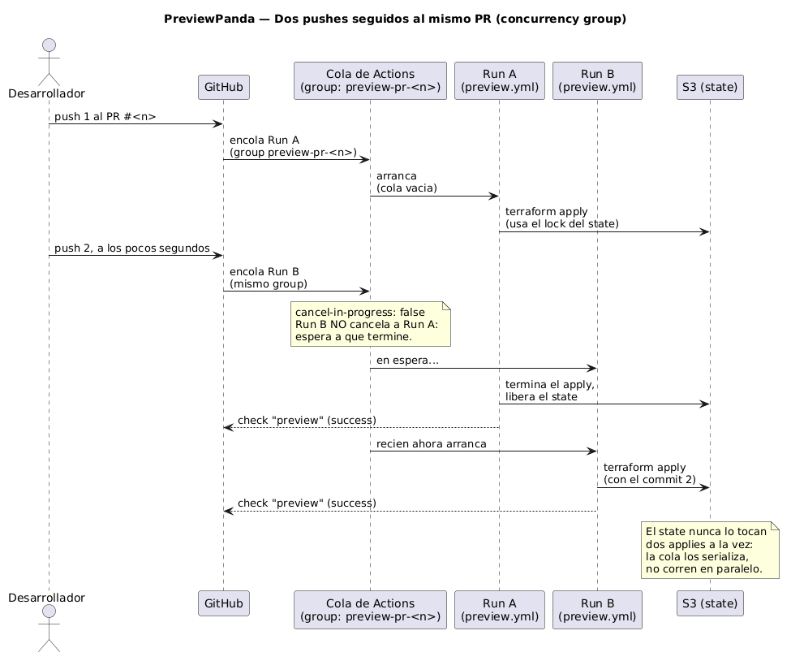
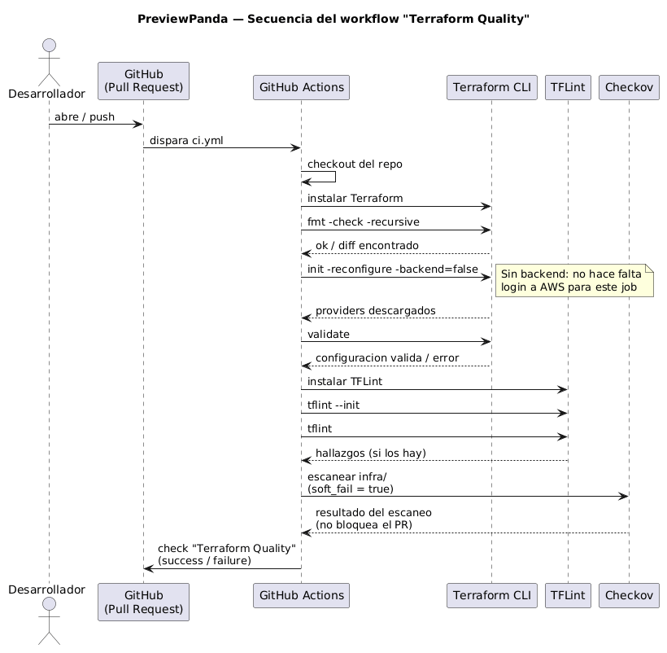
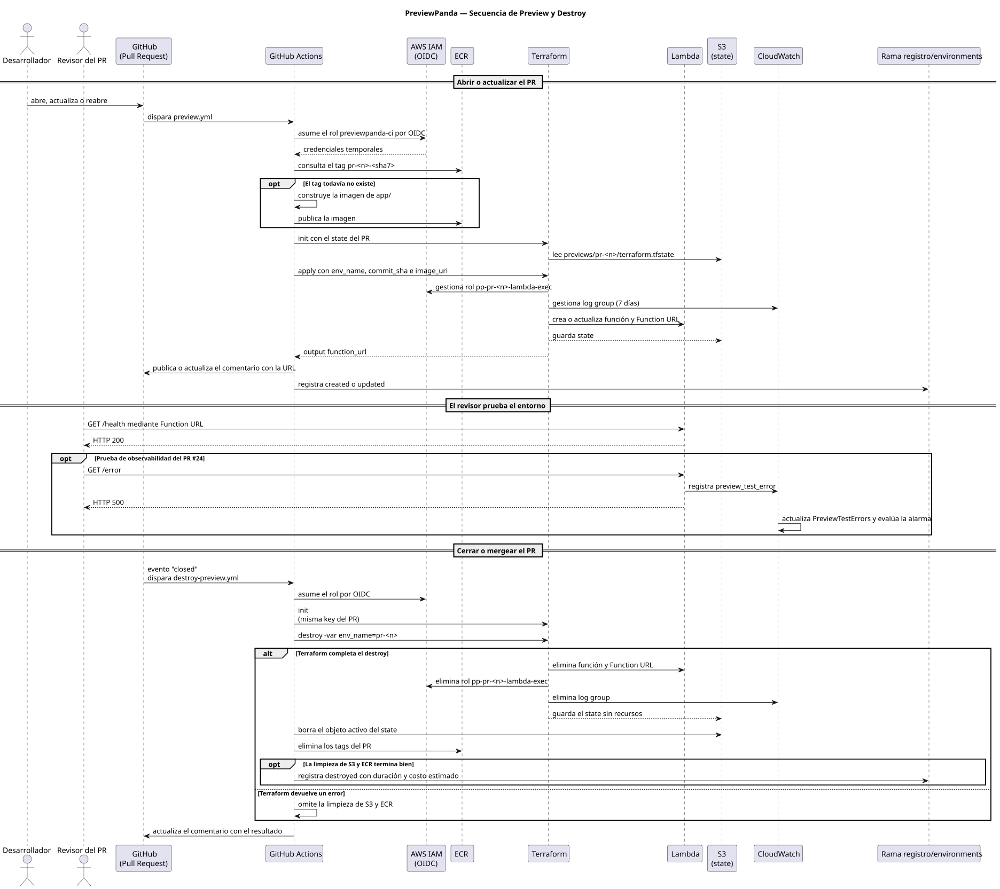

# PreviewPanda

## Informe de proyecto

**Proyecto:** PreviewPanda – entornos efímeros por Pull Request  
**Proveedor:** Amazon Web Services (AWS)  
**Repositorio:** `previewpanda`  
**Rama de desarrollo de la aplicación:** `feature/app`  
**Equipo:** `Nicolás González, Felipe Corderi, Agustín García`

## 1. Resumen

PreviewPanda crea un entorno de prueba aislado para cada Pull Request. Al abrir o actualizar un PR, GitHub Actions construye la aplicación, publica una imagen en Amazon ECR y ejecuta Terraform para crear una función AWS Lambda con una Function URL pública. La URL se publica como comentario en el PR.

Cuando el PR se cierra o se mergea, otro workflow ejecuta `terraform destroy` sobre el state correspondiente y elimina los recursos temporales. El script de limpieza de huérfanos identifica los previews cerrados que superan el tiempo definido por el equipo.

El objetivo principal no es desarrollar una aplicación compleja, sino demostrar el ciclo de vida completo de infraestructura temporal: creación, aislamiento, observación, registro de costos y destrucción.

## 2. Requisitos verificables

| # | Requisito | Implementación en PreviewPanda |
|---:|---|---|
| 1 | Cada PR tiene su propio entorno y URL | Lambda `pp-pr-<n>` con Function URL propia. |
| 2 | El entorno se destruye al cerrar o mergear | `terraform destroy` y limpieza de los recursos temporales asociados al PR. |
| 3 | Módulo Terraform reutilizable | Variable `env_name` para generar los nombres del entorno. |
| 4 | Un state por entorno | Key de S3 con el formato `previews/pr-<n>/terraform.tfstate`. |
| 5 | Etiqueta `pr=<n>` | Tags comunes aplicados a los recursos creados. |
| 6 | Limpieza de huérfanos | `scripts/cleanup_orphans.py` consulta los estados de los PR y ejecuta la destrucción de los entornos cerrados que superan el límite definido. |
| 7 | Política de concurrencia | Grupo `preview-pr-<n>` para serializar las ejecuciones del mismo PR. |
| 8 | Registro y costo por entorno | `docs/environments.csv` define los campos de evento, imagen, URL, duración y costo estimado. |

## 3. Alcance de la aplicación

La aplicación es una API Node.js con Express. Se ejecuta localmente como servidor HTTP y en AWS Lambda mediante una imagen de contenedor.

La misma imagen puede ser utilizada por cada preview. Los valores del Pull Request y del commit se reciben mediante variables de entorno:

- `PR_NUMBER`: número del Pull Request.
- `COMMIT_SHA`: commit de la imagen desplegada.

### Endpoints

| Endpoint | Propósito |
|---|---|
| `GET /` | Devuelve nombre de la aplicación, PR, commit y ruta de Swagger. |
| `GET /health` | Responde `200 ok` para health checks y smoke tests. |
| `GET /error` | Devuelve un `500` controlado para probar logs y alarmas. |
| `GET /api-docs` | Expone la documentación interactiva Swagger. |

La aplicación no incorpora base de datos, autenticación ni lógica de negocio adicional, porque el foco del proyecto es la infraestructura efímera y su automatización.

## 3.1 Pruebas de la aplicación

Las mismas rutas se prueban primero localmente y luego sobre la Function URL creada para el PR.

### `GET /`

Verifica la identidad del entorno desplegado.

```text
GET /
```

Respuesta observada en la prueba:

```json
{
  "app": "PreviewPanda",
  "pr": "12",
  "commit": "abc123d",
  "docs": "/api-docs"
}
```

La respuesta refleja el Pull Request probado y el commit usado para construir la imagen. En local, si no se configuran variables, se muestran los valores `NOT_CONFIGURED`.

### `GET /health`

Verifica que la Lambda y la aplicación respondan correctamente.

```text
GET /health
```

Resultado esperado:

```text
HTTP 200
ok
```

Esta ruta se utiliza como smoke test y como health check de la función.

### `GET /error`

Genera un error controlado para probar observabilidad.

```text
GET /error
```

Resultado esperado:

```json
HTTP 500
{
  "message": "Error de prueba"
}
```

El error es intencional. En AWS aparece en los logs de CloudWatch con la marca
`preview_test_error`. La alarma de la demo utiliza un filtro de métrica sobre
esa marca, porque un `HTTP 500` controlado no necesariamente incrementa la
métrica nativa `AWS/Lambda Errors`.

### `GET /api-docs`

Abre la interfaz Swagger de la API.

```text
GET /api-docs
```

Desde Swagger se pueden ejecutar `/`, `/health` y `/error` sobre el entorno local o sobre la Function URL del PR.

## 4. Arquitectura AWS

La arquitectura definida utiliza:

- **AWS Lambda con imagen de contenedor:** una función por Pull Request.
- **Lambda Function URL:** URL pública propia para cada preview.
- **Amazon ECR:** repositorio compartido para las imágenes Docker.
- **Amazon S3:** state remoto de Terraform.
- **GitHub Actions:** build, publicación de imagen, Terraform y comentarios en PR.
- **GitHub Actions OIDC + IAM:** autenticación sin claves estáticas.
- **Amazon CloudWatch:** logs, dashboard y alarma.

### Valores

| Dato | Valor |
|---|---|
| Región | `us-east-1` |
| Cuenta AWS | `891762599659` |
| Bucket de state | `previewpanda-tfstate-nico2026` |
| Key del state | `previews/pr-<n>/terraform.tfstate` |
| Etiquetas | `project=previewpanda`, `team=previewpanda`, `env=preview`, `owner=nicolas`, `pr=<n>` |
| Lock del state | `use_lockfile = true` |
| Rol de CI | `previewpanda-ci` |

El repositorio ECR, el bucket S3, el proveedor OIDC, el rol de CI, el presupuesto, el dashboard y la alarma son recursos compartidos. La Lambda, su Function URL, el rol de ejecución, el log group, el state y la imagen etiquetada se consideran recursos asociados a un PR.

## 5. Flujo de creación y destrucción

### Creación o actualización de un PR

1. Un desarrollador abre o actualiza un Pull Request.
2. GitHub Actions obtiene credenciales temporales mediante OIDC.
3. Se construye la imagen Docker de `app/`.
4. La imagen se publica en ECR con un tag como `pr-12-<sha>`.
5. Terraform inicializa el backend con el state del PR.
6. Terraform crea o actualiza la Lambda `pp-pr-<n>`.
7. Se crea la Function URL.
8. El workflow publica o actualiza un comentario con la URL.
9. El workflow registra el evento en `docs/environments.csv` mediante la rama `registro/environments`.

El orden build → push → apply es obligatorio, porque Lambda necesita que la imagen exista en ECR antes de crear o actualizar la función.

### Cierre o merge del PR

1. GitHub Actions detecta el cierre o merge.
2. Se recupera el mismo state `previews/pr-<n>/terraform.tfstate`.
3. Se ejecuta `terraform destroy`.
4. Se elimina la Lambda y los recursos asociados.
5. Se elimina explícitamente el objeto de state de S3.
6. Se limpia la imagen del PR en ECR.
7. El workflow registra la destrucción, la duración del entorno y el costo estimado en la rama `registro/environments`.

## 6. Concurrencia y aislamiento

Cada PR utiliza un state diferente y un grupo de concurrencia propio:

```text
preview-pr-<n>
```

Esto evita que dos ejecuciones del mismo PR modifiquen simultáneamente el mismo state. Los PR diferentes pueden ejecutarse de forma independiente.

La política se prueba con dos pushes sucesivos sobre un mismo PR y con dos PR abiertos al mismo tiempo.

## 7. Observabilidad

La aplicación dispone de `/error` para provocar una respuesta HTTP 500 controlada. La prueba de observabilidad consiste en:

1. Invocar `GET /error` en la Function URL.
2. Verificar el registro del error en CloudWatch Logs.
3. Comprobar que la métrica configurada para el error de prueba aumenta.
4. Verificar la alarma de CloudWatch.

El dashboard y la alarma se crearon en CloudWatch para el PR de demostración.
La alarma usa la métrica personalizada `PreviewTestErrors`, que se incrementa
al invocar `/error`. La retención del log group es de 7 días.

En la ejecución de demostración del PR #24 se utilizó la imagen
`pr-24-626cda2`.

Esta configuración manual está verificada en AWS y sirve para la demostración.
Por indicación del docente, el dashboard y la alarma se configuraron
directamente desde la consola de AWS. La demostración muestra el dashboard,
la alarma en estado de alarma después de invocar `/error` y la retención de
logs de 7 días.



Los log groups temporales conservan los logs durante 7 días.

## 8. Seguridad e IAM

GitHub Actions se autentica en AWS mediante OIDC. El repositorio no guarda access keys ni secret keys de AWS.

El rol `previewpanda-ci` utiliza la política mínima documentada en [docs/previewpanda-ci-policy.json](previewpanda-ci-policy.json).

La matriz IAM documenta:

- Identidad.
- Permiso.
- Recurso.
- Motivo del permiso.
- Evidencia de que no se concedieron permisos innecesarios.

## 9. FinOps

La estimación inicial del proyecto es de aproximadamente **USD 0–2 por mes**, siempre que los previews se destruyan correctamente y no se mantengan recursos costosos encendidos. El detalle de supuestos y evidencias está en [docs/finops.md](finops.md).

Las medidas principales de ahorro son:

- Lambda bajo demanda.
- Una sola región: `us-east-1`.
- Imágenes pequeñas en ECR.
- Limpieza de imágenes asociadas a PRs cerrados.
- Destrucción automática del entorno.
- Limpieza de huérfanos mediante `scripts/cleanup_orphans.py`.
- Retención de logs limitada a 7 días.

Cost Explorer mostró un costo observado de USD 0,00 para la ventana
12/11/2026–13/11/2026 en los servicios consultados. Ese dato corresponde a la
cuenta y no permite atribuir un importe exacto al PR #24. Además, está activo
el presupuesto mensual `previewpanda-presupuesto` por USD 10,00, con tres
destinatarios verificados y tres alertas asociadas por destinatario. La pestaña
de alertas confirma los umbrales 50 % (USD 5,00), 80 % (USD 8,00) y
100 % (USD 10,00), todos sin superar. La proyección productiva se mantiene
como estimación del alcance.

## 10. Registro de entornos

El archivo [environments.csv](environments.csv) contiene la plantilla con estos campos:

```text
pr_number,environment,event,occurred_at,image_tag,url,lifetime_hours,estimated_cost_usd,notes
```

El registro automático se implementa mediante
`scripts/registrar_entorno.sh`, que escribe
en la rama `registro/environments` para no modificar directamente `main`.

- El workflow de preview registra `created` al abrir o reabrir un PR y `updated`
  en cada push posterior. La fila incluye el tag de ECR, la Function URL, el
  commit y el enlace a la ejecución de GitHub Actions.
- El workflow de destroy registra `destroyed` después de completar la
  destrucción, borrar el state y eliminar las imágenes del PR. La duración se
  calcula desde la fila `created` y el costo estimado usa
  `PREVIEW_COST_USD_PER_HOUR`.
- El script reintenta el push si la rama recibió otra actualización y no hace
  fallar el deploy o el destroy cuando el registro no puede escribirse.

Las URL, las fechas y los tags se toman de ejecuciones reales; la columna
`estimated_cost_usd` representa una estimación basada en la duración del entorno.

### Ejemplo real: PR #26

El siguiente registro muestra la creación, actualización y destrucción del
entorno asociado al PR #26:

```csv
pr_number,environment,event,occurred_at,image_tag,url,lifetime_hours,estimated_cost_usd,notes
26,pr-26,created,2026-11-18T03:31:38Z,pr-26-2f13196,https://y2nwlmzzxkd27ewnbkjbs6ntnm0bngqj.lambda-url.us-east-1.on.aws/,,,commit=2f13196 run=https://github.com/NicooGon/previewpanda/actions/runs/44230884299
26,pr-26,updated,2026-11-18T03:34:42Z,pr-26-b176149,https://y2nwlmzzxkd27ewnbkjbs6ntnm0bngqj.lambda-url.us-east-1.on.aws/,,,commit=b176149 run=https://github.com/NicooGon/previewpanda/actions/runs/44231284597
26,pr-26,destroyed,2026-11-18T03:35:42Z,pr-26-b176149,,0.07,0.000007,mergeado run=https://github.com/NicooGon/previewpanda/actions/runs/44231473760
```

La primera fila registra la creación del entorno, la segunda un nuevo push
que actualiza la imagen y la tercera el cierre del PR. En la fila `destroyed`,
`lifetime_hours` indica la duración aproximada del entorno y
`estimated_cost_usd` el costo estimado para ese período. Los enlaces de
`notes` permiten relacionar cada fila con la ejecución correspondiente de
GitHub Actions.

## 11. Diagramas

La consigna requiere un diagrama de arquitectura y el artifact propone además
un diagrama de secuencia. Para explicar los controles principales del proyecto
se incluyen cinco diagramas PlantUML, en el orden usado en la presentación.

### 11.1 Diagrama de despliegue AWS

Muestra los límites entre GitHub, GitHub Actions y AWS, además de ECR, S3,
IAM, Lambda, Function URL, CloudWatch y AWS Budgets.

Archivo fuente: [diagrama-despliegue.puml](diagrams/diagrama-despliegue.puml).


### 11.2 Diagrama de actividad de limpieza de huérfanos

Este es un diagrama de actividad: representa el algoritmo del job nocturno
mediante acciones, decisiones y estados finales. Consulta si el PR sigue
abierto, calcula la antigüedad del state y destruye solo los entornos cerrados
que superan el límite definido.

Archivo fuente: [diagrama-estados-huerfanos.puml](diagrams/diagrama-estados-huerfanos.puml).



### 11.3 Diagrama de secuencia de concurrencia

Muestra cómo dos pushes sucesivos del mismo PR se serializan mediante el grupo
`preview-pr-<n>` para evitar que dos ejecuciones modifiquen el mismo state al
mismo tiempo.

Archivo fuente: [diagrama-secuencia-concurrencia.puml](diagrams/diagrama-secuencia-concurrencia.puml).



### 11.4 Diagrama de secuencia del workflow Terraform Quality

Muestra el flujo de `fmt`, `validate`, TFLint y Checkov. También deja claro que
este workflow no usa OIDC, no accede al state remoto y no crea ni destruye
recursos AWS.

Archivo fuente: [diagrama-secuencia-quality.puml](diagrams/diagrama-secuencia-quality.puml).



### 11.5 Diagrama de secuencia del ciclo del PR

Muestra la apertura, actualización, prueba y cierre del Pull Request, junto
con la interacción entre GitHub, Actions, OIDC, ECR, Terraform, S3, Lambda,
Function URL y CloudWatch.

Archivo fuente: [diagrama-secuencia.puml](diagrams/diagrama-secuencia.puml).



## 12. Componentes del proyecto

- API Express con las rutas `/`, `/health`, `/error` y `/api-docs`.
- Handler compatible con AWS Lambda y Dockerfile basado en la imagen oficial
  AWS Lambda Node.js 22.
- Workflow `Terraform Quality` con `fmt`, `validate`, TFLint y Checkov.
- Workflows de preview y destroy con imagen en ECR, Terraform, Function URL y
  limpieza de recursos temporales.
- Script `scripts/registrar_entorno.sh` para registrar automáticamente los
  eventos del entorno en la rama `registro/environments`.
- Script `scripts/cleanup_orphans.py` para identificar previews cerrados que
  superan el límite de antigüedad.
- Registro `docs/environments.csv`, informe FinOps, matriz IAM y diagramas
  PlantUML utilizados para describir la solución.

## 13. Conclusión

PreviewPanda implementa un patrón de entornos efímeros orientado a Pull Requests. La aplicación es pequeña a propósito: permite concentrar la evaluación en Terraform, aislamiento de states, CI/CD, autenticación federada, observabilidad y control de costos.

La aplicación, la imagen, la infraestructura principal, los workflows de
preview, el control de calidad, la observabilidad y la documentación forman
una solución coherente para crear, usar y destruir entornos efímeros por PR.
